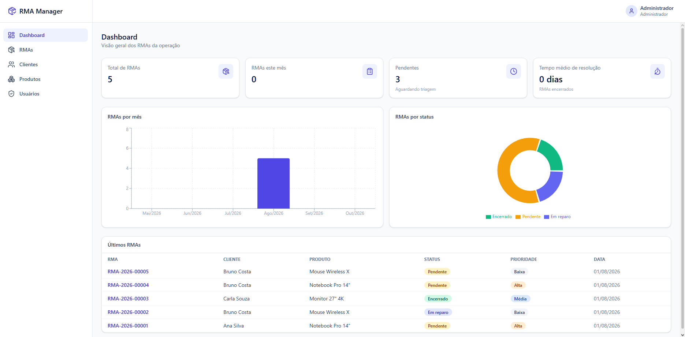
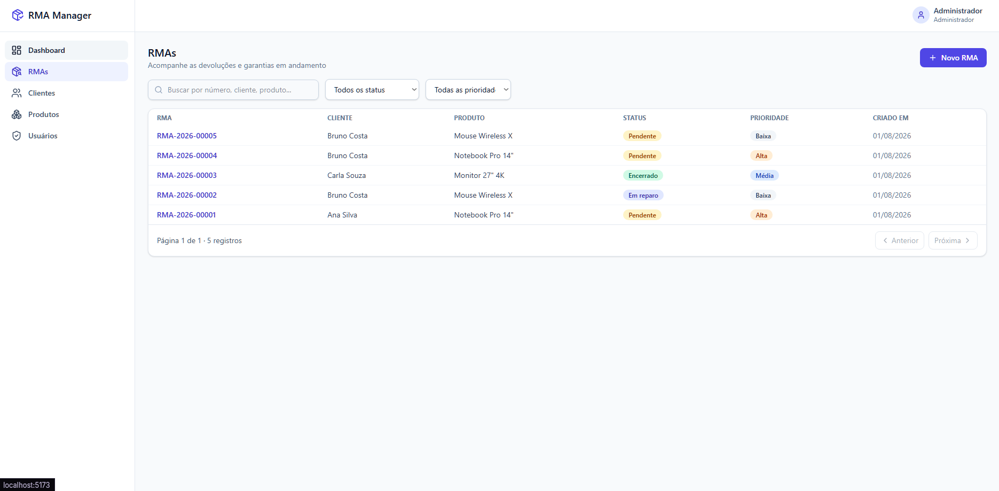
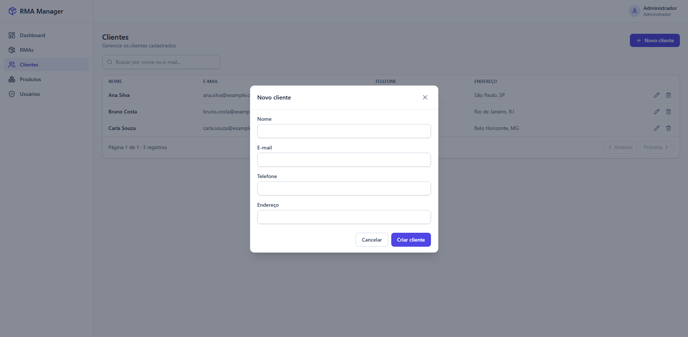
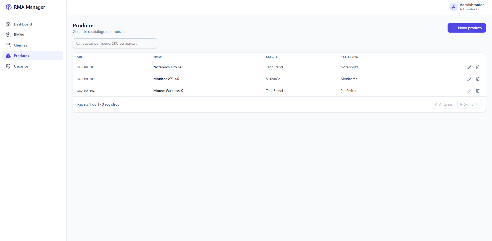

# RMA Manager

Sistema completo de gestão de **RMA (Return Merchandise Authorization)** — o fluxo pelo qual uma empresa registra, acompanha e resolve devoluções e garantias de produtos, do primeiro contato do cliente até o encerramento do caso.

Projeto full stack construído do zero como peça de portfólio, seguindo arquitetura limpa e práticas comuns em times de produto: API REST documentada, autenticação JWT com refresh token, RBAC, testes automatizados, containerização e CI.

<p>
  
  
  
  
  
  
  
</p>

##  Demonstração do Sistema

### Dashboard


### Gerenciamento de Garantias (RMAs)


### Cadastro de Clientes


### Catálogo de Produtos



## Sumário

- [Funcionalidades](#funcionalidades)
- [Stack técnica](#stack-técnica)
- [Arquitetura](#arquitetura)
- [Como rodar](#como-rodar)
- [Variáveis de ambiente](#variáveis-de-ambiente)
- [Credenciais de demonstração](#credenciais-de-demonstração)
- [Documentação da API](#documentação-da-api)
- [Testes](#testes)
- [Estrutura do repositório](#estrutura-do-repositório)
- [Decisões técnicas](#decisões-técnicas)
- [Possíveis evoluções](#possíveis-evoluções)
- [Licença](#licença)

## Funcionalidades

- **Autenticação JWT** com access token (memória) + refresh token (cookie httpOnly) e renovação automática
- **RBAC** com dois perfis (`ADMIN`, `TECHNICIAN`) protegendo rotas sensíveis (ex: gestão de usuários)
- **CRUD completo** de Clientes, Produtos, Usuários e RMAs
- **Máquina de estados** para o ciclo de vida do RMA (pendente → aprovado → em reparo → reparado/substituído/reembolsado → encerrado), com histórico de auditoria
- **Upload de imagens** por RMA (multipart, validação de tipo/tamanho, galeria com exclusão)
- **Busca, filtros e paginação server-side** em todas as listagens
- **Dashboard** com indicadores (totais, por status, por prioridade, RMAs por mês, tempo médio de resolução) e gráficos (Recharts)
- **Interface responsiva** (mobile/tablet/desktop) em Tailwind CSS v4
- **Documentação OpenAPI/Swagger** gerada a partir do próprio código (`/api/docs`)
- **Testes automatizados** no backend (Jest + Supertest) e frontend (Vitest + Testing Library + MSW)
- **Docker Compose** com Postgres, backend e frontend (Nginx), prontos para `docker compose up`

## Stack técnica

| Camada   | Tecnologias                                                                                                       |
| -------- | ----------------------------------------------------------------------------------------------------------------- |
| Frontend | React 18, TypeScript, Vite, Tailwind CSS v4, React Router, TanStack Query, React Hook Form + Zod, Recharts, Axios |
| Backend  | Node.js 20, Express, TypeScript, Zod, JWT, bcrypt, Multer, Pino, Swagger (swagger-jsdoc)                          |
| Dados    | PostgreSQL 16, Prisma ORM                                                                                         |
| Infra    | Docker, Docker Compose, Nginx, GitHub Actions                                                                     |
| Testes   | Jest, Supertest, jest-mock-extended, Vitest, Testing Library, MSW                                                 |

## Arquitetura

Monorepo com **npm workspaces**, backend e frontend desacoplados e comunicando-se via API REST:

```
rma-manager/
├── backend/                 API REST (Express + TypeScript + Prisma)
│   ├── src/
│   │   ├── modules/          auth, users, customers, products, rmas, dashboard
│   │   │   └── <modulo>/     *.routes.ts → *.controller.ts → *.service.ts → *.dto.ts
│   │   ├── middlewares/      auth, roles (RBAC), validate (Zod), upload (Multer), error
│   │   ├── config/           env (validado com Zod), swagger
│   │   ├── lib/               cliente Prisma singleton
│   │   └── utils/             ApiError, paginação, logger, etc.
│   ├── prisma/                schema, migrations, seed
│   └── tests/                  unit + integration (Jest + Supertest)
├── frontend/                 SPA (React + TypeScript + Vite)
│   └── src/
│       ├── api/               clientes HTTP por módulo (axios)
│       ├── features/          telas por domínio (auth, dashboard, rmas, customers, products, users)
│       ├── components/ui/     componentes reutilizáveis (Button, Modal, Pagination, StatusBadge...)
│       ├── context/            AuthContext (sessão, refresh silencioso)
│       └── routes/             rotas protegidas (autenticação/RBAC)
├── docker-compose.yml
└── .github/workflows/ci.yml
```

**Backend** segue separação em camadas por módulo: `routes` (validação + Swagger) → `controller` (HTTP) → `service` (regra de negócio) → Prisma (acesso a dados), com erros tratados de forma centralizada (`ApiError` + middleware de erro).

**Frontend** organizado por _feature_ (não por tipo de arquivo), com estado de servidor gerenciado pelo TanStack Query (cache, invalidação, paginação) e estado de sessão isolado em `AuthContext`.

## Como rodar

### Opção 1 — Docker Compose (recomendado)

Requer apenas [Docker](https://www.docker.com/) instalado.

```bash
git clone https://github.com/SEU_USUARIO/rma-manager.git
cd rma-manager
docker compose up --build
```

Isso sobe Postgres, aplica as migrations, popula o banco com dados de exemplo (seed) e inicia backend e frontend:

- Frontend: http://localhost:8080
- API: http://localhost:4000
- Swagger: http://localhost:4000/api/docs

### Opção 2 — Desenvolvimento local

Requer Node.js 20+ e um PostgreSQL acessível.

```bash
npm install

# configure o backend
cp backend/.env.example backend/.env
# edite backend/.env com a DATABASE_URL do seu Postgres local

npm run prisma:migrate     # aplica as migrations
npm run prisma:seed        # popula dados de exemplo

npm run dev:backend        # http://localhost:4000
npm run dev:frontend        # http://localhost:5173
```

## Variáveis de ambiente

Backend (`backend/.env`, veja `backend/.env.example`):

| Variável                                           | Descrição                                      | Padrão (dev)            |
| -------------------------------------------------- | ---------------------------------------------- | ----------------------- |
| `PORT`                                             | Porta da API                                   | `4000`                  |
| `CORS_ORIGIN`                                      | Origem permitida para requisições cross-origin | `http://localhost:5173` |
| `DATABASE_URL`                                     | Connection string do PostgreSQL                | —                       |
| `JWT_ACCESS_SECRET` / `JWT_REFRESH_SECRET`         | Segredos de assinatura dos tokens              | —                       |
| `JWT_ACCESS_EXPIRES_IN` / `JWT_REFRESH_EXPIRES_IN` | Expiração dos tokens                           | `15m` / `7d`            |
| `UPLOAD_DIR`                                       | Diretório de armazenamento das imagens         | `uploads`               |
| `MAX_UPLOAD_SIZE_MB`                               | Tamanho máximo por imagem                      | `5`                     |

Raiz do projeto (`.env`, opcional, veja `.env.example`): sobrescreve os segredos JWT usados pelo `docker-compose.yml`.

## Credenciais de demonstração

Populadas automaticamente pelo seed:

| Perfil        | E-mail                   |
| ------------- | ------------------------ |
| Administrador | `admin@rmamanager.com`   |
| Técnico       | `tecnico@rmamanager.com` |

## Documentação da API

A especificação OpenAPI é gerada a partir de anotações JSDoc no próprio código das rotas e servida via Swagger UI em **`/api/docs`** (ex: http://localhost:4000/api/docs).

Principais recursos:

```
POST   /api/auth/login
POST   /api/auth/refresh
POST   /api/auth/logout
GET    /api/auth/me

GET    /api/customers            GET /api/products            GET /api/users (ADMIN)
POST   /api/customers            POST /api/products            POST /api/users (ADMIN)
PUT    /api/customers/:id        PUT /api/products/:id         PUT /api/users/:id (ADMIN)
DELETE /api/customers/:id        DELETE /api/products/:id      DELETE /api/users/:id (ADMIN)

GET    /api/rmas                 # paginação, busca e filtros (status, prioridade, cliente, produto, datas)
POST   /api/rmas
GET    /api/rmas/:id             # inclui imagens e histórico de status
PUT    /api/rmas/:id
DELETE /api/rmas/:id
PATCH  /api/rmas/:id/status       # transição de status validada + histórico
POST   /api/rmas/:id/images       # upload multipart (até 5 imagens)
DELETE /api/rmas/:id/images/:imageId

GET    /api/dashboard/stats
```

## Testes

```bash
# backend — Jest + Supertest (unitários e de integração, Prisma mockado)
npm run test --workspace backend

# frontend — Vitest + Testing Library + MSW
npm run test --workspace frontend
```

O workflow de CI (`.github/workflows/ci.yml`) roda lint, build e testes de ambos os pacotes a cada push/PR, além de validar o build das imagens Docker.

## Estrutura do repositório

Monorepo com **npm workspaces** (`backend` e `frontend`), configuração compartilhada de ESLint/Prettier/TypeScript na raiz. Veja a árvore completa em [Arquitetura](#arquitetura).

## Decisões técnicas

- **Refresh token em cookie httpOnly + access token em memória**: reduz a superfície de exposição a XSS em comparação a manter tokens em `localStorage`.
- **RBAC simples com 2 papéis** (`ADMIN`/`TECHNICIAN`): suficiente para o domínio, sem introduzir um sistema de permissões genérico não utilizado.
- **Números de RMA sequenciais por ano** (`RMA-2026-00001`), gerados dentro de uma transação com retentativa em caso de colisão.
- **Upload local em disco** (volume Docker) em vez de object storage: simplifica a demo; a troca por S3/R2 fica isolada no módulo de upload.
- **Testes de integração do backend com Prisma mockado** (`jest-mock-extended`) em vez de um banco real: mantém a suíte rápida e determinística; a cobertura de "will it actually query Postgres correctly" fica com o schema tipado do Prisma + os testes manuais via Swagger/Docker.

## Possíveis evoluções

- Upload de imagens em object storage (S3/R2) com URLs assinadas
- Testes end-to-end (Playwright) cobrindo os fluxos completos na UI
- Notificações por e-mail nas mudanças de status do RMA
- Métricas/observabilidade (OpenTelemetry) e rate limiting por usuário
- Internacionalização (i18n) da interface

## Licença

Distribuído sob a licença MIT. Veja [LICENSE](LICENSE).

---

Desenvolvido por **Matheus Martins** — [https://www.linkedin.com/in/matheus-martins-385039324/]
